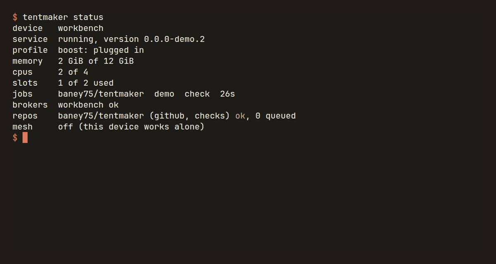

<p align="center">
  <picture>
    <source media="(prefers-color-scheme: dark)" srcset="brand/wordmark-on-dark.svg">
    
  </picture>
</p>

<p align="center"><strong>Your machines have a day job. Tentmaker gives them a second one.</strong></p>

<p align="center">
  <a href="https://github.com/baney75/tentmaker/actions/workflows/ci.yml"></a>
  <a href="https://github.com/baney75/tentmaker/actions/workflows/e2e.yml"></a>
  <a href="https://github.com/baney75/tentmaker/releases/latest"></a>
  <a href="LICENSE"></a>
</p>

Tentmaker runs your CI jobs on your own Linux, macOS and Windows machines, in throwaway sandboxes, using only the memory and CPU you give it.

```sh
curl -fsSL https://raw.githubusercontent.com/baney75/tentmaker/main/scripts/install.sh | sh
sudo tentmaker setup
```

<p align="center"></p>

> **v0.1 is the first release.** Every change runs the unit tests on Linux, macOS and Windows, installs a release on real GitHub-hosted Linux, macOS and Windows machines, runs a job through it, and attacks the sandbox fence from inside a job. Read [Project status](#project-status) before you point a repo you care about at it.

## Why

Your laptop and desktop sit idle most of the day. Hosted CI minutes cost money, and macOS minutes cost the most. Tentmaker gives CI a fixed slice of each machine you own, a bigger slice when the machine is plugged in, and nothing when the battery runs low. The fixed slice is reserved for CI, so it keeps running while you play a game or take a call; only the bigger slice gives way. Every job runs in a fresh sandbox that is thrown away afterwards, so a job can't leave anything behind for the next one or for you.

**How fast:** with a warm cache, on a GitHub-hosted VM giving each Tentmaker job 2 CPUs where the hosted job gets 4, Tentmaker ran this repo's six-target cross build in 8 s against 21 s on GitHub's hosted runner, restored a 256 MiB cache in 3 s against 9 s, and ran the Node test suite in 17 s against 19 s. Because it keeps Docker layers on the device, a rebuilt two-stage Docker image took 4 s, where the hosted runner, which keeps no layers between jobs, took 29 s. This repo's Go tests took 33 s against 30 s, the one workload the hosted runner won in this run; the [run before it](https://github.com/baney75/tentmaker/actions/runs/45105047156), on the same 2 CPUs, had Tentmaker ahead, 22 s against 33 s. Jobs started in a median 3 s (2 s hosted). Cold Go builds and tests were slower (149 s against 98 s, 159 s against 119 s), on half the CPUs. Both sides used the same Go, and every number is from one run on 2026-11-23; see [Benchmarks](docs/BENCHMARKS.md) for every number, the method and the limits.

Devices on one [Tailscale](https://tailscale.com) tailnet form a pool and share work. GitHub Actions jobs run on Tentmaker's ephemeral runners. Forgejo, Gitea and GitLab repos run in checks mode, which posts commit statuses.

## Quick start

From a checkout of your GitHub repo, on Linux or macOS:

```sh
curl -fsSL https://raw.githubusercontent.com/baney75/tentmaker/main/scripts/install.sh | sh -s -- --yes -- --repo-here --pr
```

On Windows, in an Administrator PowerShell:

```powershell
$env:TENTMAKER_YES='1'; $env:TENTMAKER_SETUP_ARGS='--repo-here --pr'; irm https://raw.githubusercontent.com/baney75/tentmaker/main/scripts/install.ps1 | iex
```

It asks nothing. An agent adds `--json` (`sh -s -- --yes --json -- --repo-here --pr`, or `$env:TENTMAKER_JSON='1'`) and gets exactly one JSON line on stdout: `ok`, the `next` step, and how long each phase took. A failure is one line too, `{"ok":false,"error":...,"fix":...}`, with the command that fixes it. See [Install time](docs/INSTALL-TIME.md) for how long it takes.

What just happened:

1. The installer put `tentmaker` on this machine and ran `sudo tentmaker setup --yes` with the repo of this checkout's `origin` and your `gh` sign-in.
2. Setup installed the sandbox and the service, and `tentmaker doctor` checked them.
3. `tentmaker migrate --pr` pushed the branch `tentmaker/migrate` and opened a pull request that moves your jobs onto this machine. Merge it, then run `tentmaker doctor` to see the first job reach your runner.

| | Tentmaker | GitHub-hosted runners | Managed runner services |
| --- | --- | --- | --- |
| Cost | Free on your own hardware | Per minute past the free allowance | Per minute |
| Personal repos | Yes | Yes | Often organizations only |
| macOS | Yes, your Mac | Yes, at the highest per-minute rate | Some, at a higher rate |
| Data that leaves your network | Job traffic only | All of it: jobs run on GitHub's machines | All of it: jobs run on their machines |

Fork pull requests stay on GitHub-hosted runners, so those still work as the fallback. Prefer to look first? Run the steps one at a time, as below.

Each installer downloads the release for your CPU, checks its sha256 against the release's `SHA256SUMS`, and refuses to install if they differ. None of them prompt.

**Linux and macOS**

```sh
curl -fsSL https://raw.githubusercontent.com/baney75/tentmaker/main/scripts/install.sh | sh
sudo tentmaker setup
```

The dev channel (rebuilt on every push to `main`):

```sh
curl -fsSL https://raw.githubusercontent.com/baney75/tentmaker/main/scripts/install.sh | sh -s -- --channel dev
```

Installer flags: `--channel stable|dev`, `--version X.Y.Z` (a specific stable release), `--prefix DIR`, `--no-setup`, and `--yes`, which runs `sudo tentmaker setup --yes` and passes along every argument after `--`:

```sh
curl -fsSL https://raw.githubusercontent.com/baney75/tentmaker/main/scripts/install.sh |
  sh -s -- --yes -- --memory 4GiB --boost-memory 12GiB --repo owner/name
```

Without root the binary goes to `~/.local/bin` instead of `/usr/local/bin`. The service runs as root, so `sudo tentmaker setup` never points it at a binary you can change: it copies the binary to `/usr/local/bin` (or `/usr/local/libexec/tentmaker`), points the service there, and tells you to remove the copy in `~/.local/bin`. On Windows the copy goes to `C:\Program Files\Tentmaker`.

**Windows** (in PowerShell opened as Administrator)

```powershell
irm https://raw.githubusercontent.com/baney75/tentmaker/main/scripts/install.ps1 | iex
tentmaker setup
```

A Windows device runs Windows jobs only (`runs-on: [self-hosted, tentmaker, Windows]`). v0.1 runs no Linux jobs on Windows.

A piped script can't take parameters, so set these first, in the same session, when you need them:

```powershell
$env:TENTMAKER_CHANNEL     = 'dev'                   # stable (default) or dev
$env:TENTMAKER_VERSION     = '0.1.0'                 # a specific stable release
$env:TENTMAKER_INSTALL_DIR = 'D:\Tools\Tentmaker'    # default: Program Files\Tentmaker
$env:TENTMAKER_NO_SETUP    = '1'                     # only install the binary
$env:TENTMAKER_YES         = '1'                     # run tentmaker setup --yes
$env:TENTMAKER_SETUP_ARGS  = '--memory 4GiB --boost-memory 12GiB --repo owner/name'
irm https://raw.githubusercontent.com/baney75/tentmaker/main/scripts/install.ps1 | iex
```

### What `sudo tentmaker setup` asks

On a terminal, setup walks you through a short wizard. Every question shows its default in brackets, and Enter takes it.

1. **Device name.** Defaults to the hostname, lowercased.
2. **Everyday memory.** What CI may use at any time. Default: a quarter of RAM, between 2 GiB and 8 GiB.
3. **Boost memory.** What CI may use while plugged in. Default: half of RAM, at most 32 GiB.
4. **On battery.** Keep running at the everyday budget (default) or stop taking jobs.
5. **Repos.** Which `owner/name` repos this device serves. It offers the `origin` of the git repo you are standing in.
6. **Forge connection.** Setup tries `gh auth token` as the user who ran sudo. If that fails, it tells you where to make a token and reads it without echo.

Then it installs the sandbox for your OS and the system service, runs `tentmaker doctor`, and prints the next step. A device without a forge token is fine: it becomes a worker that takes jobs from other devices in its pool.

Every question has a flag, so an agent can run setup with `--yes` and no questions: `--device`, `--memory`, `--boost-memory`, `--cpus`, `--boost-cpus`, `--on-battery`, `--repo`, `--forge`, `--forge-url`, `--mode`, `--token-stdin`, `--no-gh`, `--pool`, `--no-mesh` and `--channel`. `tentmaker setup --help` describes each. A device that should never hold a token gets `--no-gh` and no `--repo`.

Running setup again is safe. It keeps what you set before unless a flag changes it. It also restarts the service; running jobs keep going.

## Add a second device

From a device that already runs Tentmaker, over Tailscale SSH:

```sh
tentmaker devices add HOST
tentmaker devices add HOST --memory 4GiB --boost-memory 16GiB --repo owner/name
```

`HOST` is a tailnet name like `desktop` or `user@desktop`. The other device must allow Tailscale SSH for you, and its user must be able to run `sudo` without a password, because nobody is there to type one. Tailscale SSH has no Windows server, so for a Windows host the command prints the PowerShell line to run on that machine instead.

Or run the installer on the other device yourself. Devices on the same tailnet, owned by the same tailnet user, with the same pool name (`default` unless you change it) find each other.

```sh
tentmaker pool        # every device in the pool, its budget and free slots
```

## Use it from GitHub

Point a job at the pool with labels:

```yaml
runs-on: [self-hosted, tentmaker, linux]    # or macOS, or Windows
```

Each runner also carries its arch (`X64` or `ARM64`), `tm-<device>`, and any extra `labels` from its config.

To keep pull requests from forks on GitHub-hosted runners, use this form:

```yaml
runs-on: ${{ github.event.pull_request.head.repo.fork && 'ubuntu-latest' || fromJSON('["self-hosted","tentmaker","linux"]') }}
```

This is routing, not the security boundary: a fork PR can edit the workflow it runs. The boundary is that Tentmaker never runs a job from a fork, whatever the workflow says.

`tentmaker migrate` makes these edits for you:

```sh
tentmaker migrate                      # report what it would change in this checkout
tentmaker migrate --platform macos     # the same, for macOS jobs
tentmaker migrate --write              # edit .github/workflows in place
tentmaker migrate --pr                 # commit the edits on tentmaker/migrate and open a pull request
tentmaker migrate --all                # send fork pull requests to the pool too, where they wait
```

It leaves alone, and reports, jobs that deploy, publish, release or sign, use an environment, ask for write permissions or read secrets; Linux jobs that use `sudo`; jobs with `services:` on macOS or Windows, or `container:` on Windows, which those runners can't run; jobs that ask for a GPU or a larger runner; and runner images Tentmaker doesn't stand in for. A workflow it changes gets a concurrency block that cancels a pull request's older run.

With `--write`, review the diff and commit it yourself. With `--pr`, it refuses a dirty working tree, builds `tentmaker/migrate` from the default branch, pushes it and opens the pull request through the GitHub API (or updates the one already open). The body has a before and after table of every `runs-on` it changed. It signs in with `gh auth token`, or with the device's stored token when you run it with `sudo`.

On GitHub, runner mode needs a token that is an admin of the repo, because registering runners takes the Administration: write permission. `gh auth token` from a repo owner has it.

## Checks mode: Forgejo, Gitea and GitLab

Checks mode doesn't use the forge's runner. Tentmaker reads the workflow files at a commit, runs the jobs it understands in its own sandbox, and posts a commit status named `tentmaker/<job name>`. Make those statuses required in branch protection if you want them to gate merges.

```sh
sudo tentmaker connect forgejo --url https://forgejo.example.org --token-stdin
sudo tentmaker repo add team/app --forge forgejo --mode checks
```

Gitea uses `--forge forgejo` too; Tentmaker tells the two apart. For GitLab:

```sh
sudo tentmaker connect gitlab --url https://gitlab.example.com --token-stdin
sudo tentmaker repo add group/app --forge gitlab
```

`--token-stdin` reads the token from stdin: paste it, then press Enter and Ctrl-D. Make the token yourself: on Forgejo, Gitea or Codeberg (`--url https://codeberg.org`) under user settings > Applications with scopes `write:repository` and `read:user`; on GitLab a personal access token with scope `api`.

In v0.1 every Forgejo, Gitea and GitLab repo runs in checks mode. GitHub repos can use it too, which helps when hosted Actions won't start for a repo.

Checks mode runs pushes to the default branch and same-repo pull requests from the authors you list (the repo owner by default). It never runs forks. It understands `run` steps, `env`, `working-directory`, `continue-on-error`, `timeout-minutes`, `actions/checkout`, and the common setup actions, which it maps to tools already installed on the device. A matrix job runs once per combination, each with its own status. It skips a job with any other `uses:`, `services`, `container` or a job-level `if`; a skipped job gets no status, and `tentmaker logs` says why ("check job skipped").

Checks mode doesn't download toolchains. A setup action such as `actions/setup-go` uses a matching version on the device's `PATH` or one unpacked under the tools folder, `/var/lib/tentmaker/tools/<tool>-<version>/` (Windows: `%ProgramData%\Tentmaker\state\tools\<tool>-<version>\`). For example, as root: `cp -a "$(go env GOROOT)" /var/lib/tentmaker/tools/go-1.25.5`. The folder name only orders candidates; the binary's own version decides. The full list is in [docs/DESIGN.md](docs/DESIGN.md#checks-mode-internalchecks-internalforgegitlab).

## The budget

Each device has two profiles, and the budget engine picks one every two seconds.

| When | Profile | Default |
| --- | --- | --- |
| Always, unless something below applies | everyday | a quarter of RAM (2 to 8 GiB), a quarter of the CPUs (at least 1) |
| Plugged in, or a desktop with no battery | boost | half of RAM (at most 32 GiB), half of the CPUs |
| On battery | `on_battery`: everyday or off | everyday; no new jobs below 40%, running jobs stopped below 15% |
| Inside a schedule window | the window's profile: everyday, boost or off | no windows |

Boost can also wait until you have been away for a while (`boost_needs_idle`, `idle_after`, default 10 minutes). A schedule window set to boost still needs AC power.

A device takes as many jobs as fit: each job reserves 2 GiB and 2 CPUs by default. When the budget shrinks, the device drains: it takes no new jobs and lets running ones finish. Only low battery and very low disk stop running jobs.

Guards pause CI when the machine needs itself: less than 20 GiB free disk or less than 2 GiB of memory left for you after a job. A process you list (a game, a video call) or load above a limit you set drops boost back to the everyday budget, which stays reserved for CI. `tentmaker pause` stops CI entirely for a while.

```sh
tentmaker budget                                        # current profile and why
sudo tentmaker budget set --memory 4GiB --boost-memory 12GiB
sudo tentmaker budget set --on-battery off
sudo tentmaker schedule add --name nights --days daily --from 22:00 --to 07:00 --profile boost
sudo tentmaker pause --for 2h video call
sudo tentmaker resume
```

The guards and the job size have no flags. Edit them in the config file (every key is in [docs/config.md](docs/config.md)), run `tentmaker doctor` to check it, and restart the service: `sudo systemctl restart tentmaker` on Linux, `sudo launchctl kickstart -k system/dev.tentmaker.daemon` on macOS, `Restart-Service Tentmaker` in an Administrator PowerShell.

## Let your agent do it

Tentmaker is built so an agent (Claude Code, Codex and others) can install and run it for you. Every command takes `--json` and `--yes`, never prompts without a terminal, and exits with a stable code.

Paste this to your agent:

```text
Read https://raw.githubusercontent.com/baney75/tentmaker/main/skills/tentmaker/SKILL.md
and follow it to set up Tentmaker on this machine for my repo OWNER/NAME.
Ask me before you touch a public repo or give any device a forge token.
```

To keep the skill installed for Claude Code, save that file as `~/.claude/skills/tentmaker/SKILL.md`.

Tentmaker also serves an MCP server. Register it with Claude Code:

```sh
claude mcp add tentmaker -- tentmaker mcp
```

Its read tools (`status`, `pool`, `doctor`, `runs`, `logs`, `stats`, `wait_for_run`) work as any user. Tools that change the device need the MCP server to run as root or Administrator, and return an error that says so otherwise. See [docs/agents.md](docs/agents.md).

## Watch your CI

Every device keeps a record of each job it ran: conclusion, the step that failed, queue wait,
duration, peak memory and CPU seconds from the job's cgroup on Linux, and a redacted tail of the
log. The pool view merges every device's records over the tailnet, so one command shows them
all.

```text
$ tentmaker runs
CONCLUSION         REPO          JOB        DEVICE  QUEUED  DURATION  PEAK MEM  ENDED      ID
running            baney75/app   build      mac     -       2m00s     -         -          tm-mac-1
failure (go test)  baney75/site  ci / test  box     30s     4m30s     3.0GiB    5m00s ago  tm-box-1
success            baney75/site  ci / lint  box     -       1m00s     512MiB    8m00s ago  tm-box-2

$ tentmaker logs tm-box-1 -n 4
    login_test.go:41: got 500, want 200
FAIL
FAIL	github.com/baney75/site/auth	0.311s
##[error]Process completed with exit code 1.

$ sudo tentmaker rerun tm-box-1
Asked the forge to rerun the failed jobs of run 41 in baney75/site (through box).

$ tentmaker stats --since 7d
REPO          JOBS  FAILED  QUEUE P50  QUEUE P95  RUN P50  RUN P95  MINUTES  EST. SAVED
baney75/site  2     50%     30s        30s        1m00s    4m30s    6        $0.04
Last 7d. estimated saving: billed minutes at GitHub-hosted per-minute rates as of 2026-01-01 (Linux $0.006, Windows $0.010, macOS $0.062); an estimate, not a bill
```

`tentmaker logs JOB-ID --follow` streams a running job. Alerts go to ntfy, Slack, Discord or any
webhook on failure, on recovery and on slow jobs; see `[[alerts]]` in
[docs/config.md](docs/config.md) and check them with `sudo tentmaker alerts test`. An agent gets
the same through MCP, plus `wait_for_run`, which blocks until a commit's jobs end and returns the
failed step and the last 80 log lines ([docs/agents.md](docs/agents.md)).

## Security model

**Fork pull requests never run.** The broker refuses any job whose head repo differs from the repo, cancels the run if a fork job reaches a runner anyway, and deletes that runner. Checks mode never looks at forks.

**Public repos are refused** unless you pass `--allow-public` and the repo requires approval before any outside contributor's workflow runs. `sudo tentmaker repo add OWNER/NAME --allow-public --enable` sets that approval on GitHub for you. Approval for first-time contributors only is not enough.

**Runners are single use.** On GitHub each runner gets a just-in-time config for one job, then the forge retires it and the sandbox is deleted. The JIT config reaches the runner on stdin or through a root-only file, never in argv, an environment variable or a log.

**Sandboxes per OS:**

- **Linux:** each job runs as the unprivileged user `tentmaker-runner` (no sudo, no docker group, `NoNewPrivileges`) in a transient systemd unit with hard memory, CPU and process limits, a fresh runner copy, its own home, its own repo's build cache and a network namespace of its own: servers a job starts on 127.0.0.1 work, the host's loopback services stay out of reach. Container steps use rootless podman.
- **macOS:** each job gets its own Tart VM cloned from a digest-pinned image, deleted afterwards. Softnet blocks the VM from your tailnet, your LAN, link-local addresses and the Mac itself.
- **Windows:** each job runs as the local standard user `tentmaker-runner` inside a Job Object with hard memory and CPU caps, in a fresh directory only that user can open. The loopback fence that keeps it off this device's services also keeps it off servers it starts on 127.0.0.1 or ::1, so tests that run a local server fail on Windows. `tentmaker doctor` says so on every Windows device; send those jobs to a Linux or macOS device.

**Jobs can't reach your network.** On Linux, setup loads nftables rules (iptables when nft is missing) for the `tentmaker-runner` user, and `tentmaker-net.service` loads them again at boot before Tentmaker starts. On Windows, setup adds Windows Firewall outbound rules for that user (group "Tentmaker") for other hosts, and Windows Filtering Platform filters for traffic to this device, which Windows Firewall does not filter. Jobs reach the internet, DNS and the one-job source URL on 127.0.0.1:7435, and nothing else: no tailnet (100.64.0.0/10, fd7a:115c:a1e0::/48), no LAN (10/8, 172.16/12, 192.168/16), no link-local or cloud metadata, no other service on this device, and no mesh port 7433 anywhere. Container steps go through the same rules. `[guards] allow_lan = true` opens the LAN only; rerun `sudo tentmaker setup` after changing it. When the rules are missing or out of date, the device takes no jobs and `tentmaker doctor` says why. The fence is not the only wall: the control API names each caller by its account and refuses the runner user on every OS, and the peer API refuses any request from the device itself.

**Tokens stay on broker devices.** A forge token lives only on the devices you gave one to, in the OS secret store. Workers and jobs never see it. In checks mode the broker downloads the source archive from the forge itself and streams it to the worker it granted the check to; the job gets it from a one-job loopback URL on its own device (macOS VMs get a copy of the file), never a forge URL or token.

**The tailnet is the identity.** The peer API listens only on tailnet addresses and serves only devices owned by the same tailnet user, or logins you list in `mesh.members`. Tagged devices are refused unless you list `tagged-devices`.

**What is not protected:**

- A Linux or Windows job shares your kernel. A kernel or Windows privilege bug can let it out. Only macOS jobs run in a VM.
- The network rules stop a job from connecting out to your tailnet, LAN and this device. They don't stop a job from using the internet, and they don't protect a LAN service from a job when you set `allow_lan`. A LAN that numbers its devices with public IPv4 addresses looks like the internet to them. The rules follow a new IPv6 prefix, Tailscale interface or address at the next job's start, not in the middle of a running job.
- Linux and Windows jobs all run as the same user. While two jobs run at once on one device, one can read the other's files and processes. A Linux repo cache is the exception: while a job holds one, the device takes only that repo's trusted jobs, so no other repo's job or fork job runs beside it to read it through `/proc`.
- On Linux each repo keeps a build cache (Go, npm, pip, cargo and the tool cache) and a container store (podman's images, layers and Docker build cache) between its jobs, capped by `cache_max`. It is per repo, not per branch: a job on any branch can leave something a later job of that repo picks up, a tampered layer included, and a digest in `FROM` doesn't catch that, because podman doesn't hash a cached layer again on use. Another repo's jobs and fork jobs never get it, and a runner-mode repo gets it only when it is private with fork pull request workflows turned off. macOS and Windows jobs start cold. With the device cache, `actions/setup-go` and similar actions work best with `cache: false`.
- Anyone who can push to a repo you serve can run code on your machines. On a public repo, so can code you merge from outside contributors, and workflows they can trigger on the repo itself, such as one that runs on issue comments. Fork pull requests still never run.
- A compromised forge account or token can queue jobs on your devices.

Report a vulnerability through [SECURITY.md](SECURITY.md).

## Channels and updates

There are two channels and no others.

- **stable:** GitHub Releases tagged `vX.Y.Z`.
- **dev:** one rolling prerelease tagged `dev`, rebuilt on every push to `main`, versioned like `0.1.1-dev.202611211530.abc1234`.

With `update.auto` on (the default) a device checks every 6 hours and updates only between jobs. `tentmaker update` pauses new jobs and waits up to 30 minutes for running ones to finish, since the restart would end them; if they don't finish, or it can't tell whether the service is running jobs, it changes nothing and resumes. `--force` updates without waiting and ends running jobs. An update verifies the sha256, checks the new binary runs, swaps it in, restarts the service, and rolls back if the service isn't healthy within 60 seconds. Updates and rollbacks change only the root-owned binary the service runs.

```sh
sudo tentmaker update --check
sudo tentmaker update
sudo tentmaker rollback
tentmaker version
```

To move a device to the dev channel, save the channel with setup, then update. `update --channel dev` on its own installs one dev build and leaves auto-updates on the saved channel.

```sh
sudo tentmaker setup --yes --channel dev    # keeps every other value
sudo tentmaker update
```

## Uninstall

```sh
sudo tentmaker uninstall           # remove the service and the sandboxes
sudo tentmaker uninstall --purge   # also delete config, secrets, state, cache and logs
```

An agent adds `--yes`, since it has no terminal to confirm on. Workflows you pointed at the pool wait for a runner after the last device that serves them is gone, so change their `runs-on` back first.

On Windows, run `tentmaker uninstall` in an Administrator PowerShell. If the binary is still there afterwards, delete it: `/usr/local/bin/tentmaker` (or `~/.local/bin/tentmaker`), or `C:\Program Files\Tentmaker\tentmaker.exe`.

## Where things live

| | Linux | macOS | Windows |
| --- | --- | --- | --- |
| config | `/etc/tentmaker/config.toml` | `/Library/Application Support/Tentmaker/config.toml` | `%ProgramData%\Tentmaker\config.toml` |
| logs | journald, unit `tentmaker` | `/Library/Logs/Tentmaker/tentmaker.log` | `%ProgramData%\Tentmaker\logs\tentmaker.log` |
| service | `tentmaker.service` | `/Library/LaunchDaemons/dev.tentmaker.daemon.plist` | Windows service `Tentmaker` |

`tentmaker logs -f` follows the log on any OS. `tentmaker doctor` checks the service, sandbox, forge credentials, tailnet, disk, memory and config, and prints the fix for each problem. For each GitHub repo it also checks the first job: that GitHub lists a Tentmaker runner online for the repo, or that a job already ran on one.

## Requirements

- Linux with systemd and cgroup v2, pasta (the `passt` package) for each job's own network namespace, podman for container steps; amd64 or arm64.
- macOS on Apple silicon. The Softnet network filter needs macOS 26 or newer.
- Windows on amd64 or arm64.
- Tailscale on every device that joins a pool. A single device can run with `--no-mesh`.

## Project status

Tentmaker is new. v0.1 is the first release line, and its contracts may still change.

**Proven in CI on every push:** unit tests for every package on Linux, macOS and Windows, with fake forges, sandboxes, power sources and tailnets; a cross-build for all six OS and CPU pairs; the release archives and their checksums; and both installers run end to end (install.sh on Linux and macOS, install.ps1 under Windows PowerShell 5.1 and PowerShell 7).

**Proven on real machines:** the e2e workflow installs a release on GitHub-hosted Linux, macOS and Windows machines, sets it up as a service and runs a real job through the sandbox. The abuse workflows run attacks from inside a job against the network fence, the memory and process limits and the other jobs on the device, and fail if one gets through. Tests behind the `live` build tag read real power, idle, disk, memory and Tailscale state.

**Not proven yet:** a pool of several devices over a real tailnet for days, and laptops on battery. Please [open an issue](https://github.com/baney75/tentmaker/issues) when you hit a rough edge.

Not in v0.1: Linux jobs on Windows through WSL2, runner mode for Forgejo and Gitea, and build caches for macOS and Windows jobs.

## Contributing

See [CONTRIBUTING.md](CONTRIBUTING.md). The design contract is [docs/DESIGN.md](docs/DESIGN.md) and the command line contract is [docs/CLI.md](docs/CLI.md).

## License

[MIT](LICENSE)

The name comes from Paul, Aquila and Priscilla, who made tents for a living so their real work could go on (Acts 18:3). Your machines have a day job. Tentmaker gives them a second one.
