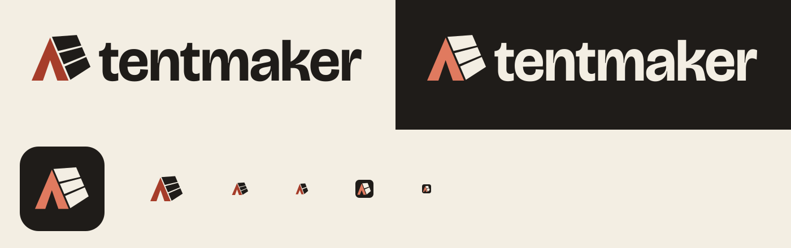

# Tentmaker brand



## Why this name and mark

"And because he was of the same trade he stayed with them and worked, for they were tentmakers by
trade" (Acts 18:3, ESV). Paul made tents so his preaching cost no one anything (Acts 20:34,
2 Thessalonians 3:8). Tentmaker does
the same for your machines: they keep their day job, and in the hours they would sit idle they
run your CI.

Tradition ties Paul's trade to cilicium, the goat-hair cloth of his home province, Cilicia, woven
in long strips and sewn edge to edge. The mark is that tent seen from the corner: the door panel in front,
and the woven side running back, three strips sewn together.

Tagline: **Your machines have a day job. Tentmaker gives them a second one.**

## Files

| File | Use |
| --- | --- |
| `mark.svg`, `mark-on-dark.svg` | The mark, two tone. 32 px and up |
| `mark-small.svg`, `mark-small-on-dark.svg` | One seam instead of two, for 16 to 24 px |
| `mark-mono.svg` | One color, `currentColor`, for single-ink use |
| `wordmark.svg`, `wordmark-on-dark.svg` | Mark plus the name, outlined from Bricolage Grotesque |
| `icon.svg`, `icon-full-bleed.svg` | App icon on the dark tile, rounded or square |
| `favicon.svg` | The small mark on the dark tile, for browser tabs |
| `social.svg` | The 1280 by 640 card for link previews and GitHub's social preview |
| `export/` | PNGs of the icon (180 to 1024), favicons (16, 32, 48 and `favicon.ico`) and `social.png` |
| `tools/gen.py` | Draws every SVG above |
| `tools/export.sh` | Renders `export/` and `brand-sheet.png` (needs librsvg and ImageMagick 7) |

To rebuild, download the font at its pinned commit, then run both tools:

```sh
curl -fsSLo /tmp/bricolage.ttf 'https://raw.githubusercontent.com/google/fonts/06bfe0d62a98375cb09c942fa18e68bd32cff057/ofl/bricolagegrotesque/BricolageGrotesque%5Bopsz,wdth,wght%5D.ttf'
uv run --no-project --with fonttools --with uharfbuzz python brand/tools/gen.py /tmp/bricolage.ttf brand
brand/tools/export.sh
```

## Color

| Role | Hex | Contrast |
| --- | --- | --- |
| Madder, primary | `#A63D2A` | 5.46 on Linen |
| Cilicium, dark neutral and text | `#1F1C19` | 14.66 with Linen |
| Linen, light neutral | `#F3EEE3` | |
| Madder light, primary on dark | `#E07A5F` | 5.75 on Cilicium |
| Ochre, working and warnings | `#8A6420` on light, `#D6A64F` on dark | 4.62 on Linen, 7.61 on Cilicium |

Madder root was a common red dye in Paul's world; goat-hair cloth was black. Red appears in the
terminal only for failures, so the brand red stays out of status text.

## Type

Bricolage Grotesque (SIL Open Font License 1.1) for the wordmark and headings, Bold at optical
size 96 for the name. The name is lowercase, like the command. Code and terminal text use the
reader's monospace font.

## Rules

- Clear space: the height of one woven strip on every side.
- Minimum size: the mark at 32 px, the small mark at 16 px, the wordmark at 24 px tall.
- The two-tone mark goes on Linen or white. On Madder, use the dark tile (`icon.svg`), since
  Cilicium on Madder is only 2.68 to 1.
- Don't stretch it, recolor it outside this palette, add effects or set the name in capitals.
- Scripture and Paul's story belong here and on the project page, not in errors or buttons.
- Say what happens, in short plain sentences: "Tentmaker paused: on battery."
